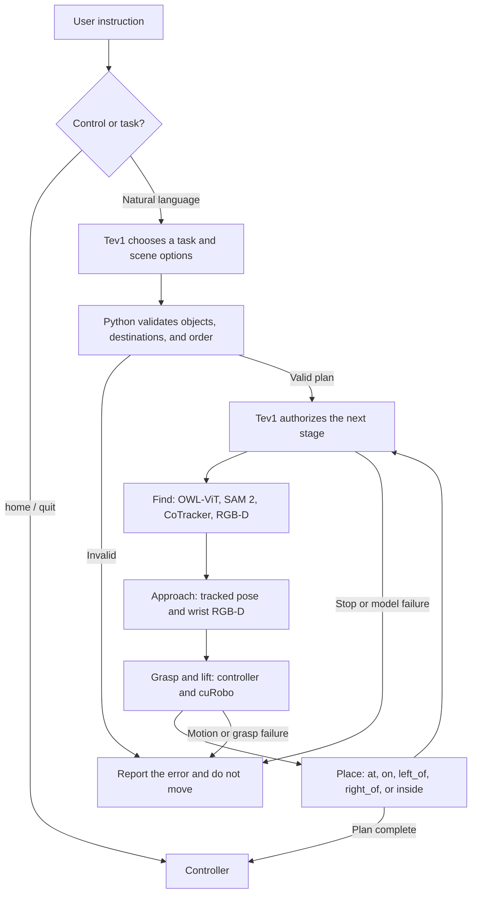

# pseudo-vla

A single-process Isaac Sim controller that turns a natural-language pick-and-place instruction into a validated plan, then tracks the objects and moves a Franka arm.

Local [Tev1](https://ollama.com) (`tev1:4b`) chooses among options in `config/tev1_questions.json`. Python checks every choice against the current scene before anything moves. Perception finds the objects, and [cuRobo](https://nvlabs.github.io/curobo) 0.8 plans the arm. Tev1 never names a Python function and never sends joint targets.

This stack was brought up on an RTX 3080 Laptop (16 GB) with Python 3.12 and Torch `2.6.0+cu124`. Leave Torch on that build. Isaac Sim 6.2's own pin is newer, and upgrading Torch breaks this stack.

## Current state

Interactive instructions go through Tev1. The model is asked only the questions that match the current decision, then the scene state is refreshed after each completed stage.

A plan is either `find`, or an ordered list of moves. Each destination is `at`, `on`, `left_of`, `right_of`, or `inside`. Object, location, and container ids come from the live scene. A plan that names anything else is rejected before the arm moves.

Two scenes are available:

- **blocks** (default). Isaac Sim's simple room. The Franka stands on the near edge of the table, facing +Y. Three 5 cm dynamic cubes sit in front of it: `red`, `green`, and `blue`. The work-surface location is `table`. There are no containers, so `inside` is rejected until a container, its collision geometry, and a placement behavior exist.
- **kitchen** (`--scene kitchen`). A counter with a dinner plate and a mug. The work-surface location is `counter`. `--stack-prompt` is not supported here.

What is in place:

- Tev1 selects the task, the objects and destinations that the scene lists, an OOAL grasp affordance, and whether the next validated stage proceeds or stops.
- The controller and cuRobo keep collision-aware motion and physical safety.
- Unit tests mock Ollama. They cover the Tev1 client, adaptive task decisions, task-plan validation, affordances, stacking compatibility, the kitchen scene, and perception helpers.

What is not established yet:

- Live Isaac Sim grasp, contact, unstacking, relative placement, and task completion have not been validated end to end. Passing unit tests do not mean a physical run succeeded.

## How a request is handled



Tev1 talks to Ollama at `POST /v1/systemone`. The client is `pseudo_vla/tev1_client.py`. It loads `config/tev1_questions.json`, sends the current state plus only the questions for this step, and checks the typed answer before anyone uses it.

The bank allows at most 64 questions. Each call uses a subset. Question types:

| Type | What Tev1 returns | How it is used |
| --- | --- | --- |
| `choice` | One option, with probabilities | Task, object, destination, stack event, affordance. 2–24 options. |
| `noul` | A probability for a yes/no question | Whether another pick-and-place action was requested. `0.5` is treated as undecided and stops the plan. |
| `score` | A level on an ordered rubric | How well a selected affordance matches the instruction. |

Choice options that depend on the scene, such as which block to move, are filled in from the current catalog. The JSON file stores the question text. It does not store a fixed list of blocks.

Routing lives in `pseudo_vla/task_llm.py`:

1. `task_intent` — `find`, `pick_place`, or `unsupported`.
2. For `find`, `find_target` picks one listed object.
3. For `pick_place`, `plan_more` asks whether another requested move remains. Each move then asks `moving_object`, `destination_kind`, and, when several targets exist, `destination_target`. At most six actions.
4. `validate_task_plan` in `pseudo_vla/task_plan.py` checks ids, destination kinds, self-placement, and support cycles.
5. `pseudo_vla/task_workflow.py` asks `task_event` before find, plan, approach, grasp, lift, place, and placement verification. The only legal answers are the expected event or `stop`.

`pseudo_vla/stacking_llm.py` is the block-scene path on top of that router. `--stack-prompt` asks `stack_base` and `stack_next` for a full red/green/blue order before Isaac Sim starts. During that run, `stack_event` authorizes each pair. A free-text stack such as `stack blue on red` goes through the general task router, then the same physical stacking phase.

Grasp regions use the same client. `pseudo_vla/affordance.py` asks `affordance_family`, `affordance_label`, and `affordance_fit` against OOAL's seen classes. `none`, or a weak fit, keeps the full SAM mask. A model error stops before motion. Those labels are grasp options, not robot tasks.

A timeout, HTTP error, malformed answer, unknown id, or `stop` halts the workflow. There is no second model and no fallback that grounds the text and moves anyway.

`OLLAMA_HOST` overrides `http://localhost:11434`. The client timeout is 120 seconds.

## Perception and motion

One process shares the GPU across Isaac Sim, SAM 2, CoTracker3, OWL-ViT, and cuRobo. SAM 2 and OWL-ViT load once and stay resident. CoTracker keeps receiving frames while idle and during motion, and is reseeded when a new prompt selects an object.

Two cameras:

- **Environment camera.** Fixed in front of the arm. This is the image perception uses. The window titled "SAM + CoTracker" shows the mask and tracked points.
- **Wrist camera.** Mounted on the gripper and aimed into the fingers. The window titled "Wrist Camera" shows this view. Wrist RGB-D refines alignment before a grasp.

A color named by an object id is boxed from the image. Other phrases use OWL-ViT. SAM 2 is seeded on those boxes. Depth from the same camera turns CoTracker points into the 3D approach. Positions used for collision boxes, clearance, and placement come from that depth. A place is reported only when a new depth measurement shows the object at the destination.

cuRobo treats the table, or the kitchen counter, and the other objects as cuboid obstacles, including the object being approached. The grasped object is left out of collision checks only while the fingers are supposed to touch it. The arm replans when the 3D goal moves. A taller neighbor is cleared with a higher transit waypoint before the 10 cm hover.

Numeric prompts (`x y` or `x1 y1 x2 y2`) skip Tev1 and approach that image point or box directly. `home` returns the hand to the startup pose. `quit` closes Kit.

## Setup

From the repo root.

### 1. Conda environment

`environment.yml` creates the `ps_vla` env with Python 3.12 and the build tools SAM 2 and cuRobo need (`pip`, `ninja`, `cmake`, `git`, `git-lfs`). It does not install PyTorch, Isaac Sim, or the models. Those come from pip in the steps below.

```bash
conda env create -f environment.yml
conda activate ps_vla
```

### 2. PyTorch

Install Torch 2.6 for CUDA 12.4 before the rest of the stack:

```bash
pip install torch==2.6.0+cu124 torchvision torchaudio --index-url https://download.pytorch.org/whl/cu124
```

### 3. Python dependencies

`requirements.txt` installs Isaac Sim 6.2, CoTracker, Transformers, and `cuda-core[cu12]`. cuRobo needs that CUDA 12 backend. Without it, `MotionPlannerCfg.create` fails with "No curobo kernel backend available".

```bash
pip install -r requirements.txt
pip install 'nvidia-curobo==0.8.0.post1.dev43' --extra-index-url https://pypi.nvidia.com
```

If a later install upgrades Torch, pin it back:

```bash
pip install torch==2.6.0+cu124 torchvision torchaudio --index-url https://download.pytorch.org/whl/cu124
```

### 4. SAM 2 and CoTracker weights

Clone SAM 2 into this repo and install it editable. Keep the Torch pin if that install tries to change it.

```bash
git clone https://github.com/facebookresearch/sam2.git segment-anything-2
SAM2_BUILD_CUDA=1 pip install -e segment-anything-2
pip install torch==2.6.0+cu124 torchvision torchaudio --index-url https://download.pytorch.org/whl/cu124
```

Download the SAM 2 base-plus checkpoint and the CoTracker3 online checkpoint:

```bash
mkdir -p checkpoints
wget -O checkpoints/sam2_hiera_base_plus.pt \
  https://dl.fbaipublicfiles.com/segment_anything_2/072824/sam2_hiera_base_plus.pt
mkdir -p ~/.cache/torch/hub/checkpoints
wget -O ~/.cache/torch/hub/checkpoints/scaled_online.pth \
  https://huggingface.co/facebook/cotracker3/resolve/main/scaled_online.pth
```

`segment-anything-2/` and `checkpoints/` are gitignored.

The first run downloads `google/owlvit-base-patch32` into the Hugging Face cache. Isaac Sim downloads the simple room and Franka from its asset server on first launch, so that run needs network access.

### 5. Tev1

Free-text instructions need a local Ollama server and the 4B decision model. Use Ollama 0.35 or later.

```bash
ollama pull tev1:4b
```

Confirm the server is up before launching Isaac Sim. The default address is `http://localhost:11434`.

### 6. OOAL, for grasp heatmaps

Affordance selection imports the seen-class list from a local OOAL checkout at `OOAL/` (gitignored). Put the seen-class checkpoint at either of these paths:

- `checkpoints/ooal-models/seen_best`
- `OOAL/models/checkpoints/seen_best`

Without the checkout, grasp-affordance selection cannot load the class list and the pick stops. Without the checkpoint, Tev1 can still choose a label, but the heatmap is unavailable and the controller tracks the full SAM mask instead.

### 7. Check the GPU stack

```bash
python -c "import torch, curobo, cotracker, sam2; print(torch.cuda.is_available(), torch.cuda.get_device_name(0))"
```

## Run

From the repo root, with `ps_vla` active and a display available:

```bash
export OMNI_KIT_ACCEPT_EULA=YES
python scripts/track_and_servo.py
```

The first Kit launch is slow. Later launches are faster. At `Instruction>` you can type:

- `find the green block` — locate and segment the object. The arm stays put.
- `stack blue on red` — move blue onto red.
- `unstack the tower` — move supported blocks to `table`, outermost first. Tev1 sees the observed `supported_by` relations. Python accepts an id only when it is in the scene.
- `put blue to the left of red` or `put green to the right of blue` — place a block beside another. The robot faces +Y, so left is world −X and right is world +X.
- `home` — return the hand to its startup pose.
- `quit` — close Kit.

`at table` uses that block's original table slot and is rejected before motion when the slot is occupied. The same occupancy check applies to `left_of` and `right_of`.

Useful flags:

```bash
python scripts/track_and_servo.py --instruction "stack blue on red"
python scripts/track_and_servo.py --scene kitchen
python scripts/track_and_servo.py --stack-prompt "stack green, then red, then blue"
python scripts/track_and_servo.py --headless
python scripts/track_and_servo.py --max-steps 600
```

`--instruction` submits one task after startup. `--target` is a deprecated alias for it. `--stack-prompt` is the legacy full-stack launch: Tev1 must name red, green, and blue, the order is bottom to top, and the placements run without a pause between them. `--max-steps` is how many simulator steps one move may take before the prompt returns. The default is 600.

The same launch through conda, without activating the env first:

```bash
OMNI_KIT_ACCEPT_EULA=YES conda run -n ps_vla python scripts/track_and_servo.py \
  --instruction "put blue to the left of red"
```

Kitchen example:

```bash
OMNI_KIT_ACCEPT_EULA=YES conda run -n ps_vla python scripts/track_and_servo.py \
  --scene kitchen --instruction "hold mug and place it on the plate"
```

Each run writes its terminal output to a new file under `outputs/logs/`. `outputs/logs/latest.log` points at the newest one. Step details that are not printed are appended to that file. The first segmented frame is saved to `outputs/frame0_overlay.png`.

## Tests

```bash
conda run -n ps_vla python -m unittest discover -s tests -v
```

Tests mock Ollama. They do not need a running model or Isaac Sim.

## Layout

| Path | Role |
| --- | --- |
| `environment.yml` | Conda env `ps_vla`: Python 3.12 and build tools |
| `requirements.txt` | Isaac Sim 6.2, CoTracker, Transformers, CUDA 12 core |
| `scripts/track_and_servo.py` | Process entry point |
| `pseudo_vla/cli.py` | CLI options and Isaac Sim lifecycle |
| `pseudo_vla/controller.py` | Interactive loop and robot execution |
| `pseudo_vla/tev1_client.py` | Validated `/v1/systemone` client |
| `config/tev1_questions.json` | Question bank: text, type, and fixed rubrics |
| `pseudo_vla/task_llm.py` | Task routing and stage authorization |
| `pseudo_vla/task_plan.py` | Typed plan and scene-catalog checks |
| `pseudo_vla/task_workflow.py` | Ordered execution of a validated plan |
| `pseudo_vla/stacking_llm.py` | Block-stack order and stack-event choices |
| `pseudo_vla/stacking_workflow.py` | Stack state machine; motion stays in the controller |
| `pseudo_vla/affordance.py` | Tev1 affordance choice and OOAL grasp sampling |
| `pseudo_vla/motion.py` | Pose execution, homing, tracker and camera updates |
| `pseudo_vla/servo.py` | cuRobo planner and joint playback |
| `pseudo_vla/scene.py` | Franka, cameras, and the active scene |
| `pseudo_vla/blocks.py` | Block colors, size, and table layout |
| `pseudo_vla/kitchen.py` | Counter, plate, and mug |
| `pseudo_vla/perception.py` | SAM 2 and CoTracker3 |
| `pseudo_vla/grounding.py` | OWL-ViT text grounding |
| `pseudo_vla/geometry.py` | Projection, depth, and robot-frame geometry |
| `pseudo_vla/view.py` | Wrist viewport and the SAM + CoTracker window |
| `pseudo_vla/runlog.py` | Per-run log under `outputs/logs/` |
| `scripts/plan.md` | Historical Llama/d3 plan. The live path is Tev1, documented above |
| `checkpoints/` | SAM 2 weights, and optionally the OOAL seen checkpoint |
| `segment-anything-2/` | Local SAM 2 clone |
| `OOAL/` | Local OOAL checkout used for seen affordance classes |

`scripts/plan.md` records the earlier Llama and d3 design. The running code does not call those models.
