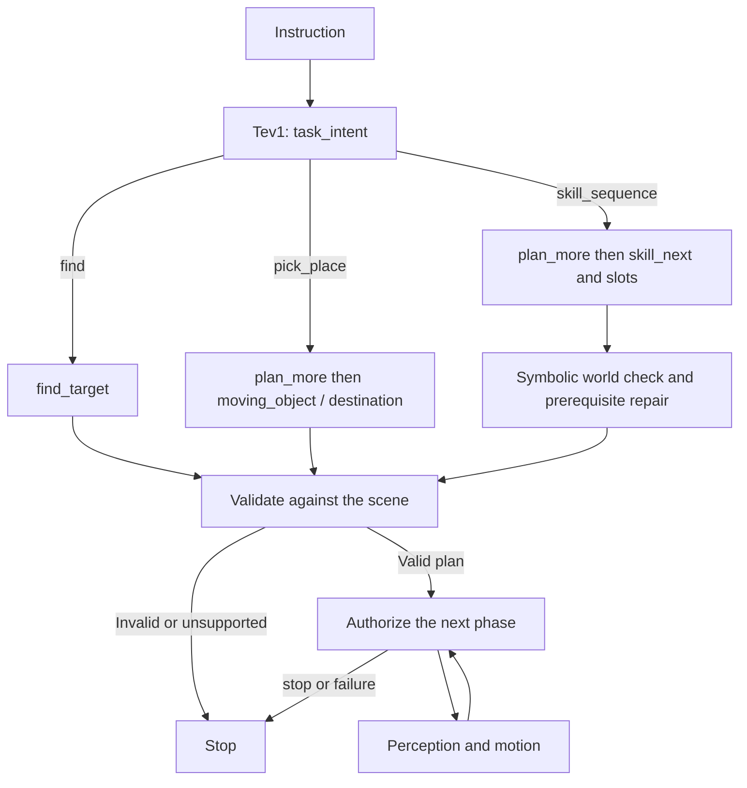

# pseudo-vla

The purpose of this project is to develop a zero-shot system that lets you prompt a robot in natural language and complete the requested task, without task-specific training or fine-tuning for each instruction.

It is a single-process Isaac Sim controller for a Franka arm. A prompt becomes a validated skill plan, perception tracks the objects, and [cuRobo](https://nvlabs.github.io/curobo) moves the arm. Local [Tev1](https://ollama.com) (`tev1:4b`) only chooses among options that Python computed from the live scene and the skill registry. It never names a Python function and never sends joint targets. Perception, grasp affordances, and motion stay behind thin adapters.

Pin Torch to `2.6.0+cu124`. Isaac Sim 6.2's own pin is newer, and upgrading Torch breaks this stack.

## Flow



1. **Route.** `task_intent` picks `find`, `pick_place`, `skill_sequence`, or `unsupported`.
2. **Plan.** `find` names one listed object. `pick_place` fills one or more moves with the scene catalog. `skill_sequence` fills registered skills one slot at a time (`skill_next`, then each skill's slots). A slot with a single real option is filled without a Tev1 call. Every choice list includes `none` or `unsupported`.
3. **Check.** Each step is checked against a symbolic world (`held`, `on`, `inside`, `opened`). A blocked step may insert an automatic repair (park the held object, clear the one blocker, open the closed container) or ask Tev1 when more than one repair is legal.
4. **Authorize.** Before each phase, Tev1 may proceed with the expected phase, take one recovery from a fixed failure table, or stop. Retry caps live in code.
5. **Execute.** OWL-ViT grounds text, SAM 2 seeds CoTracker and is then released, CoTracker tracks through the motion, OOAL can narrow a grasp region, and cuRobo plans collision-aware trajectories.

Registered skills include pick, place, open, close, push, press, rotate, insert, extract, stack, unstack, pour, use_tool, hang, wait, go_home, repeat, and ask_clarification. `pick_place`, `stack`, and `unstack` are stored as pick then place.

Tev1 talks to Ollama at `POST /v1/systemone` through `pseudo_vla/tev1_client.py`. Questions live in `config/tev1_questions.json`. Set `OLLAMA_HOST` to override `http://localhost:11434`. Set `TEV1_CALL_LOG` to a file path to append each call as JSONL. The client timeout is 120 seconds.

## Scenes

| Scene | Surface | Objects | Notes |
| --- | --- | --- | --- |
| `blocks` (default) | `table` | `red`, `green`, `blue` | Franka faces +Y. Left is world −X, right is world +X. |
| `kitchen` | `counter` | `plate`, `mug` | Side grasp for hold-style mug moves. `--stack-prompt` is rejected. |

Destination kinds are `at`, `on`, `left_of`, `right_of`, and `inside`. Ids come from the live scene. A plan that names anything else is rejected before the arm moves.

## Perception and motion

One process shares the GPU across Isaac Sim, OWL-ViT, SAM 2, CoTracker3, OOAL, and cuRobo. OWL-ViT stays loaded. SAM 2 loads for the seed frame, then is released. CoTracker keeps environment-camera frames through approach, grasp, lift, and place, and keeps both the moving object and its support.

| Camera | Role |
| --- | --- |
| Environment Camera | Fixed view used for grounding, seeding, and tracking. CoTracker points are drawn here. |
| Wrist Camera | Gripper view. Blocks refine alignment with wrist RGB-D. Side grasps project environment tracks into the wrist. |

A side grasp, such as holding the mug and placing it on the plate, keeps the grasp orientation, lifts 40 cm, and hovers 30 cm above the plate. Set-down uses Isaac Sim world collision bounds of the mug and plate at that hover: the hand lowers by the vertical gap minus 1 cm. A gap under 1 cm or over 45 cm keeps the geometric place height.

Numeric prompts (`x y` or `x1 y1 x2 y2`) skip Tev1 and approach that image point or box. `home` returns the hand to the startup pose. `quit` closes Kit.

## GPU memory

Isaac Sim and the perception stack share one GPU. Tev1 usually runs in a separate Ollama process and may use additional memory if it is also on GPU.

| Component | Typical VRAM | Notes |
| --- | --- | --- |
| Isaac Sim + Franka scene | 6–10 GB | Dominates residency for the whole run |
| OWL-ViT base | ~0.5–1 GB | Stays loaded |
| SAM 2 Hiera base+ | ~1–2 GB | Loaded to seed CoTracker, then released |
| CoTracker3 online | ~1 GB | Stays loaded during motion |
| cuRobo Franka planner | ~1–2 GB | Peak during planning |
| OOAL seen checkpoint | ~0.5–1 GB | Loaded when a grasp affordance is chosen |
| Whole process | ≥16 GB recommended | Isaac Sim's published minimum for RTX GPUs with RT cores |

## Setup

From the repo root.

### 1. Conda environment

```bash
conda env create -f environment.yml
conda activate ps_vla
```

### 2. PyTorch

```bash
pip install torch==2.6.0+cu124 torchvision torchaudio --index-url https://download.pytorch.org/whl/cu124
```

### 3. Python dependencies

```bash
pip install -r requirements.txt
pip install 'nvidia-curobo==0.8.0.post1.dev43' --extra-index-url https://pypi.nvidia.com
```

cuRobo needs the CUDA 12 backend from `requirements.txt`. Without it, planner creation fails. If a later install upgrades Torch, pin it back to `2.6.0+cu124`.

### 4. SAM 2 and CoTracker weights

```bash
git clone https://github.com/facebookresearch/sam2.git segment-anything-2
SAM2_BUILD_CUDA=1 pip install -e segment-anything-2
pip install torch==2.6.0+cu124 torchvision torchaudio --index-url https://download.pytorch.org/whl/cu124

mkdir -p checkpoints
wget -O checkpoints/sam2_hiera_base_plus.pt \
  https://dl.fbaipublicfiles.com/segment_anything_2/072824/sam2_hiera_base_plus.pt
mkdir -p ~/.cache/torch/hub/checkpoints
wget -O ~/.cache/torch/hub/checkpoints/scaled_online.pth \
  https://huggingface.co/facebook/cotracker3/resolve/main/scaled_online.pth
```

`segment-anything-2/` and `checkpoints/` are gitignored. The first run downloads `google/owlvit-base-patch32` and Isaac Sim assets, so it needs network access.

### 5. Tev1

```bash
ollama pull tev1:4b
```

Use Ollama 0.35 or later. Confirm the server is up before launching Isaac Sim.

### 6. OOAL, for grasp heatmaps

Put a local OOAL checkout at `OOAL/` (gitignored) and the seen-class checkpoint at `checkpoints/ooal-models/seen_best` or `OOAL/models/checkpoints/seen_best`. Without the checkout, affordance selection cannot load the class list. Without the checkpoint, Tev1 can still choose a label, but the controller tracks the full SAM mask.

### 7. Check the GPU stack

```bash
python -c "import torch, curobo, cotracker, sam2; print(torch.cuda.is_available(), torch.cuda.get_device_name(0))"
```

## Run

```bash
export OMNI_KIT_ACCEPT_EULA=YES
python scripts/track_and_servo.py
```

At `Instruction>`:

- `find the green block` — locate and segment the object
- `stack blue on red` — move blue onto red
- `unstack the tower` — clear supported blocks to `table`, outermost first
- `put blue to the left of red` — place beside another object
- `hold mug and place it on the plate` — kitchen side grasp and set-down
- `home` / `quit` — return the hand, or close Kit

Useful flags:

```bash
python scripts/track_and_servo.py --instruction "stack blue on red"
python scripts/track_and_servo.py --scene kitchen --instruction "hold mug and place it on the plate"
python scripts/track_and_servo.py --stack-prompt "stack green, then red, then blue"
python scripts/track_and_servo.py --headless
python scripts/track_and_servo.py --max-steps 600
```

`--instruction` submits one task after startup. `--stack-prompt` asks Tev1 for a full red/green/blue bottom-to-top order before Isaac Sim starts, then runs those placements without a pause. `--max-steps` is how many simulator steps one move may take. The default is 600.

Each run writes terminal output under `outputs/logs/`. `outputs/logs/latest.log` points at the newest file. The first segmented frame is saved to `outputs/frame0_overlay.png`.

## Layout

| Path | Role |
| --- | --- |
| `scripts/track_and_servo.py` | Process entry point |
| `pseudo_vla/cli.py` | CLI options and Isaac Sim lifecycle |
| `pseudo_vla/controller.py` | Interactive loop and robot execution |
| `pseudo_vla/tev1_client.py` | Validated `/v1/systemone` client |
| `config/tev1_questions.json` | Question bank |
| `pseudo_vla/task_llm.py` | Intent routing and legacy stage authorization |
| `pseudo_vla/planner.py` | Skill-sequence planning and prerequisite repair |
| `pseudo_vla/skills.py` | Symbolic world and skill registry |
| `pseudo_vla/phases.py` | Phase authorization and recovery table |
| `pseudo_vla/phase_handlers.py` | Perception and motion adapters |
| `pseudo_vla/task_plan.py` | Typed plan and scene-catalog checks |
| `pseudo_vla/task_workflow.py` | Plan execution |
| `pseudo_vla/affordance.py` | Tev1 affordance choice and OOAL grasp sampling |
| `pseudo_vla/perception.py` | SAM 2 seeding, then CoTracker3 |
| `pseudo_vla/grounding.py` | OWL-ViT text grounding |
| `pseudo_vla/motion.py` | Pose execution, homing, tracker and camera updates |
| `pseudo_vla/servo.py` | cuRobo planner and joint playback |
| `pseudo_vla/scene.py` | Franka, cameras, active scene, collision bounds |
| `pseudo_vla/blocks.py` / `kitchen.py` | Scene props |
| `pseudo_vla/geometry.py` | Projection, depth, collision gap, robot-frame geometry |
| `pseudo_vla/view.py` | Camera windows |
| `pseudo_vla/runlog.py` | Per-run log under `outputs/logs/` |
| `pseudo_vla/eval_plans.py` | Prompt-suite scoring for the planner |
| `DECISIONS.md` | Ambiguous design choices for the skill registry |
