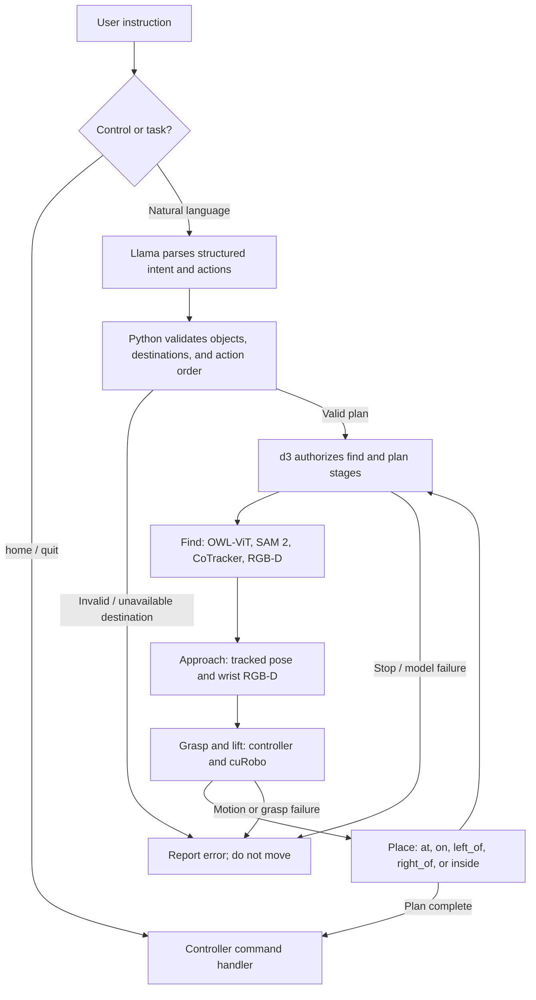

# pseudo-vla

A single-process Isaac Sim loop that finds an object, tracks it, and moves a Franka arm to it.

The environment camera finds the object. [SAM 2](https://github.com/facebookresearch/sam2) masks it on the first frame, [CoTracker3](https://github.com/facebookresearch/co-tracker) follows points on that mask, and the depth image turns those points into a 3D goal. [cuRobo](https://nvlabs.github.io/curobo) 0.8 plans a collision-free joint path, and the arm follows it. The session stays open so you can send another object or send the arm home.

This was brought up on an RTX 3080 Laptop (16 GB) with Python 3.12 and Torch 2.6.0+cu124. Leave Torch on that build. Isaac Sim 6.2's own pin is newer, and upgrading Torch breaks this stack.

## Project status

- Interactive natural-language instructions pass through local Llama
  (`llama3.2:3b`) and are parsed into a validated find request or an ordered
  pick-and-place plan.
- Plans use a scene-neutral pick-and-place contract: `find`, or ordered moves
  with destination kind `at`, `on`, `left_of`, `right_of`, or `inside`. Object,
  location, and container ids come from the current scene state. In this scene
  those are the red, green, and blue blocks and the `table` location. A plan
  that names anything else is rejected before robot motion.
- d3 (`d3:4b`) selects whether each validated task stage proceeds or stops.
  The controller and cuRobo retain responsibility for collision-aware motion,
  grasping, placement, and physical safety; model output is never sent to joints.
- The scene still contains only red, green, and blue cubes on a table. There
  are no containers, so an `inside` destination is rejected until a container,
  its collision geometry, and a placement behavior are added.
- Automated tests pass. Live Isaac Sim grasp, contact, unstacking, and relative
  placement have not yet been validated end-to-end.

## Pipeline



Llama proposes a structured plan; Python validates it against the current scene;
d3 selects among bounded task events. OWL-ViT, SAM 2, CoTracker, and RGB-D
localize objects. The controller and cuRobo execute motion and enforce physical
safety checks.

## What is in the scene

Isaac Sim's simple room, with the Franka standing on the near edge of the table. Three 5 cm dynamic cubes sit in front of it: a red block, a green block, and a blue block.

Two cameras:

- **Wrist camera.** Mounted on the gripper and aimed into the fingers. The Isaac window titled "Wrist Camera" shows this view.
- **Environment camera.** Fixed in front of the arm. Perception uses this image. The window titled "SAM + CoTracker" shows the mask and the tracked points.

cuRobo treats the table and all three blocks as cuboid obstacles, including the block being approached.

## Layout

| Path | Role |
| --- | --- |
| `scripts/track_and_servo.py` | Thin executable entry point |
| `pseudo_vla/cli.py` | CLI options, model parsing, and Isaac Sim lifecycle |
| `pseudo_vla/controller.py` | Interactive task loop and robot-specific execution |
| `pseudo_vla/stacking_workflow.py` | d3-driven stack state machine; delegates each physical pair to the controller |
| `pseudo_vla/task_plan.py` | Typed pick-and-place plan and pre-motion validation |
| `pseudo_vla/task_llm.py` | Generic task interpretation and d3 task-event decisions |
| `pseudo_vla/task_workflow.py` | Ordered model-orchestrated task execution |
| `pseudo_vla/motion.py` | Pose execution, homing, tracker updates, and camera-view updates |
| `pseudo_vla/scene.py` | Room, Franka, colored blocks, and both cameras |
| `pseudo_vla/blocks.py` | Shared block colors, dimensions, and scene specifications |
| `pseudo_vla/grounding.py` | OWL-ViT text grounding |
| `pseudo_vla/perception.py` | SAM 2 segmentation and CoTracker3 tracking |
| `pseudo_vla/geometry.py` | Camera projection, depth unprojection, and robot-frame geometry |
| `pseudo_vla/servo.py` | cuRobo planner and joint playback |
| `pseudo_vla/view.py` | Wrist viewport and the SAM + CoTracker window |
| `config/` | Llama and d3 model prompts, response schema, and event-choice templates |
| `checkpoints/` | SAM 2 weights (not committed) |
| `segment-anything-2/` | Local SAM 2 clone, installed editable (not committed) |

## Install

Create the conda env from the repo root:

```bash
conda env create -f environment.yml
conda activate ps_vla
```

Install Torch 2.6 for CUDA 12.4 before anything else:

```bash
pip install torch==2.6.0+cu124 torchvision torchaudio --index-url https://download.pytorch.org/whl/cu124
```

Then the rest of the Python dependencies. `requirements.txt` lists Isaac Sim 6.2, CoTracker, and Transformers. If a later install upgrades Torch, pin it back to `2.6.0+cu124`.

```bash
pip install -r requirements.txt
pip install 'nvidia-curobo==0.8.0.post1.dev43' --extra-index-url https://pypi.nvidia.com
```

`cuda-core[cu12]` is in `requirements.txt`. cuRobo needs that CUDA 12 backend; without it, `MotionPlannerCfg.create` fails with "No curobo kernel backend available".

Clone SAM 2 into this repo and install it editable. Keep Torch pinned if that install tries to change it.

```bash
git clone https://github.com/facebookresearch/sam2.git segment-anything-2
SAM2_BUILD_CUDA=1 pip install -e segment-anything-2
pip install torch==2.6.0+cu124 torchvision torchaudio --index-url https://download.pytorch.org/whl/cu124
```

Download the SAM 2 base-plus checkpoint and the CoTracker3 online checkpoint:

```bash
mkdir -p checkpoints
wget -O checkpoints/sam2_hiera_base_plus.pt \
  https://dl.fbaipublicfiles.com/segment_anything_2/072824/sam2_hiera_base_plus.pt
mkdir -p ~/.cache/torch/hub/checkpoints
wget -O ~/.cache/torch/hub/checkpoints/scaled_online.pth \
  https://huggingface.co/facebook/cotracker3/resolve/main/scaled_online.pth
```

The first run downloads `google/owlvit-base-patch32` into the Hugging Face cache. Isaac Sim downloads the simple room and Franka from its asset server on first launch, so that run needs network access.

Check that the GPU stack imports:

```bash
python -c "import torch, curobo, cotracker, sam2; print(torch.cuda.is_available(), torch.cuda.get_device_name(0))"
```

## Run

From the repo root, with the `ps_vla` env active and a display available:

```bash
export OMNI_KIT_ACCEPT_EULA=YES
python scripts/track_and_servo.py
```

The first Kit launch is slow. Later launches are much faster. At `Instruction>`, enter a natural-language request:

- `find the green block` locates and segments the requested object without moving the arm.
- `stack blue on red` moves only blue onto red.
- `unstack the tower` asks for supported blocks to be moved to the `table` location, outermost first. Llama sees `supported_by` from the scene; Python accepts the returned ids only when they are in that scene.
- `put blue to the left of red` or `put green to the right of blue` places blocks beside another block.
- Type `home` to return the hand to its startup pose, or `quit` to close Kit.
- Numeric point and box prompts (`x y` or `x1 y1 x2 y2`) remain available for direct visual targeting.
- `--instruction "stack blue on red"` submits a task immediately after startup. `--target` remains a deprecated alias.
- `--stack-prompt "stack green, then red, then blue"` is retained as a legacy full-stack launch option.

Free-text instructions require local Ollama with `llama3.2:3b` and `d3:4b`.
Llama returns a typed find request or explicit ordered actions; Python validates
the plan against scene objects and destinations before any motion. d3 uses the
typed `/v1/systemone` choice API at task-stage boundaries. Model/API failures
stop the workflow; they do not fall through to direct visual grounding.
`OLLAMA_HOST` can override the default `http://localhost:11434` server address.

Task prompts and structured-output schemas are in `config/llama_task_plan.json`
and `config/d3_task.json`. The older stack-only launch path uses
`config/llama_stacking.json` and `config/d3_stacking.json`. Python validation
remains authoritative for supported objects and destinations.

Planned pick-and-place actions approach a selected block, use wrist RGB-D to refine alignment, close the gripper, lift it, move to the validated destination, and release it. Direct numeric pixel/box prompts retain the legacy behavior of approaching and grasping without a destination. The source block is omitted from cuRobo collision checks only during intentional contact; the table and other blocks remain obstacles.

Each pick-and-place action finds the blocks in the environment camera. A color named by the object id is boxed from the image; other phrases use OWL-ViT. SAM is seeded on those boxes. Scene state always lists the scene's object ids, and includes a position only after a depth measurement. Object positions used for collision boxes, clearance, and placement come from unprojecting that camera's depth. A place is reported only when a new depth measurement shows the object at the destination. CoTracker points unprojected through the same depth drive the approach. A seen OOAL affordance named in the instruction, such as hold in "hold mug and place it on the plate", supplies the heatmap. SAM still segments the grasped object and the placement target. CoTracker points for the grasped object are sampled on the hot part of that heatmap inside the SAM mask. Those 3D points are projected into the wrist camera, and wrist depth at the projected pixels aligns the gripper before it descends onto the same points. The placement target keeps points across its full mask. Wrist segmentation refines the hover only when the instruction names no seen affordance. The gripper stays open if that wrist view cannot localize the object. Stacking on another block drops the moving block's points after the grasp and uses the tracked support surface for placement. Table, left, and right placements use the validated geometric destination: a block's clear home slot, or a pose beside the reference block. The robot faces +Y, so left is world -X and right is world +X. Projected positions only seed SAM; the environment and wrist depth images provide 3D approach and grasp measurements. The moved block's collision geometry is refreshed from a new environment-camera depth measurement after each phase.

Useful flags:

```bash
python scripts/track_and_servo.py --instruction "stack blue on red" # general task prompt
python scripts/track_and_servo.py --scene kitchen             # counter with plates, mugs, and utensils
python scripts/track_and_servo.py --target "red block"        # deprecated --instruction alias
python scripts/track_and_servo.py --stack-prompt "stack green, then red, then blue" # legacy full-stack mode
python scripts/track_and_servo.py --headless                  # no Isaac windows
python scripts/track_and_servo.py --max-steps 600             # steps allowed for one move
```

Run a general task in the project's Conda environment:

```bash
OMNI_KIT_ACCEPT_EULA=YES conda run -n ps_vla python scripts/track_and_servo.py \
  --instruction "put blue to the left of red"

The default scene is the simple room with red, green, and blue blocks. `--scene kitchen` builds a separate counter kitchen. Its manipulable objects are a dinner plate and a mug. The work surface location is `counter`. `--stack-prompt` stays on the block scene.
```

Each simulator run saves its terminal output to a new file under `outputs/logs/`, and `outputs/logs/latest.log` points at the newest one. Step details that are not printed are appended to that same file. The first segmented frame is saved to `outputs/frame0_overlay.png`.

## Implemented behavior and validation

- One process shares the GPU across Isaac Sim, SAM 2, CoTracker3, OWL-ViT, and cuRobo.
- SAM 2 and OWL-ViT load once when perception starts and stay resident on the GPU between prompts.
- CoTracker continues receiving camera frames while idle and during motion, grasping, and lifting; it is reseeded when a new prompt selects an object.
- Coarse perception uses environment-camera RGB-D; immediately before stacking grasps, wrist-camera RGB-D refines the cube's center and top surface. The wrist camera and the environment-camera overlay are docked on the right of the scene view.
- Tracked points identify the selected block, then the scene block bounds define a centered 10 cm hover pose with the hand pointing down.
- The arm replans when the 3D goal moves. All blocks, including the current target, plus the table, are collision cuboids during approach. Only the selected block is temporarily omitted for intentional finger contact and lifting.
- After approach, the gripper closes around the selected block and attempts a 20 cm lift. It keeps holding the block until another command arrives, then opens before handling that command. The controller checks whether the block followed the gripper.
- Free-text instructions pass through Llama as a find request or an ordered list of pick-and-place actions. Destination kinds are `at`, `on`, `left_of`, `right_of`, and `inside`. The scene state supplies the legal object, location, and container ids. Numeric points/boxes and control commands bypass Llama.
- In this scene, `at table` uses the moved block's designated initial table slot and is rejected before motion when that slot is occupied. `left_of` and `right_of` mean negative and positive scene/world X, with a small collision clearance.
- `inside` is rejected before motion because this scene lists no containers.
- `--stack-prompt` requires red, green, and blue and interprets the requested bottom-to-top order before simulator startup. It runs all requested placements without inter-placement pauses.
- d3 uses the typed `/v1/systemone` choice API to authorize find, plan, approach, grasp, and place boundaries. Invalid, unavailable, or stop decisions halt the workflow; d3 does not directly command robot joints.
- Pickup beside a taller nearby block first routes to a higher transit waypoint, then descends to the 10 cm hover pose so the approach clears that block. A block that is already the local high point approaches its hover pose directly.
- Automated validation: `conda run -n ps_vla python -m unittest discover -s tests -v` passes 81 tests. The suite covers scene-neutral task-plan validation, d3 stops, relative placement, stack compatibility, and perception helpers.
- Not yet verified: end-to-end grasp, contact, table unstacking, relative placement, and task completion in a live Isaac Sim session. Passing unit tests do not establish physical execution success.
