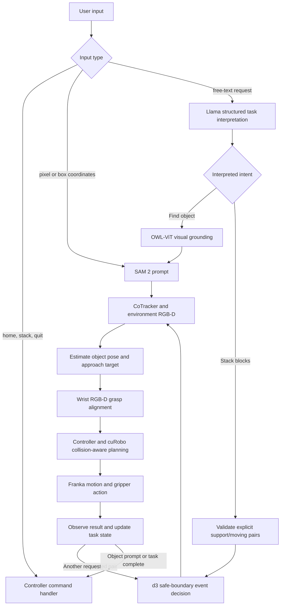

# pseudo-vla

A single-process Isaac Sim loop that finds an object, tracks it, and moves a Franka arm to it.

The environment camera finds the object. [SAM 2](https://github.com/facebookresearch/sam2) masks it on the first frame, [CoTracker3](https://github.com/facebookresearch/co-tracker) follows points on that mask, and the depth image turns those points into a 3D goal. [cuRobo](https://nvlabs.github.io/curobo) 0.8 plans a collision-free joint path, and the arm follows it. The session stays open so you can send another object or send the arm home.

This was brought up on an RTX 3080 Laptop (16 GB) with Python 3.12 and Torch 2.6.0+cu124. Leave Torch on that build. Isaac Sim 6.2's own pin is newer, and upgrading Torch breaks this stack.

## Project status

- The interactive controller supports natural-language object searches and
  natural-language stacking requests through local Llama (`llama3.2:3b`).
- Object requests are converted into visual queries before OWL-ViT grounding.
  Stack requests are parsed into explicit support/moving pairs, so
  `stack blue on top of red` requests only that placement. A multi-placement
  request runs only its explicitly requested pairs, in support-first order.
- d3 (`d3:4b`) is used for safe-boundary task-event decisions during stacking.
  The existing controller owns perception, motion planning, collision handling,
  grasping, and execution; model output is not sent to robot joints.
- `--stack-prompt` remains a separate full-stack option: it requires all three
  colors and takes their order bottom-to-top.
- Automated tests and local Llama parsing have been checked. Live Isaac Sim
  grasp, contact, and stacking behavior has not yet been validated end-to-end.

## Pipeline



Llama interprets user language; OWL-ViT, SAM 2, CoTracker, and RGB-D provide
visual localization and tracking. d3 can select only from the allowed task
events, while the controller and cuRobo retain responsibility for physical
execution and safety checks.

## What is in the scene

Isaac Sim's simple room, with the Franka standing on the near edge of the table. Three 5 cm dynamic cubes sit in front of it: a red block, a green block, and a blue block.

Two cameras:

- **Wrist camera.** Mounted on the gripper and aimed into the fingers. The Isaac window titled "Wrist Camera" shows this view.
- **Environment camera.** Fixed in front of the arm. Perception uses this image. The window titled "SAM + CoTracker" shows the mask and the tracked points.

cuRobo treats the table and all three blocks as cuboid obstacles, including the block being approached.

## Layout

| Path | Role |
| --- | --- |
| `scripts/track_and_servo.py` | Thin executable entry point |
| `pseudo_vla/cli.py` | CLI options, model parsing, and Isaac Sim lifecycle |
| `pseudo_vla/controller.py` | Interactive task loop and robot-specific execution |
| `pseudo_vla/stacking_workflow.py` | d3-driven stack state machine; delegates each physical pair to the controller |
| `pseudo_vla/motion.py` | Pose execution, homing, tracker updates, and camera-view updates |
| `pseudo_vla/scene.py` | Room, Franka, colored blocks, and both cameras |
| `pseudo_vla/blocks.py` | Shared block colors, dimensions, and scene specifications |
| `pseudo_vla/grounding.py` | OWL-ViT text grounding |
| `pseudo_vla/perception.py` | SAM 2 segmentation and CoTracker3 tracking |
| `pseudo_vla/geometry.py` | Camera projection, depth unprojection, and robot-frame geometry |
| `pseudo_vla/servo.py` | cuRobo planner and joint playback |
| `pseudo_vla/view.py` | Wrist viewport and the SAM + CoTracker window |
| `config/` | Llama and d3 model prompts, response schema, and event-choice templates |
| `checkpoints/` | SAM 2 weights (not committed) |
| `segment-anything-2/` | Local SAM 2 clone, installed editable (not committed) |

## Install

Create the conda env from the repo root:

```bash
conda env create -f environment.yml
conda activate ps_vla
```

Install Torch 2.6 for CUDA 12.4 before anything else:

```bash
pip install torch==2.6.0+cu124 torchvision torchaudio --index-url https://download.pytorch.org/whl/cu124
```

Then the rest of the Python dependencies. `requirements.txt` lists Isaac Sim 6.2, CoTracker, and Transformers. If a later install upgrades Torch, pin it back to `2.6.0+cu124`.

```bash
pip install -r requirements.txt
pip install 'nvidia-curobo==0.8.0.post1.dev43' --extra-index-url https://pypi.nvidia.com
```

`cuda-core[cu12]` is in `requirements.txt`. cuRobo needs that CUDA 12 backend; without it, `MotionPlannerCfg.create` fails with "No curobo kernel backend available".

Clone SAM 2 into this repo and install it editable. Keep Torch pinned if that install tries to change it.

```bash
git clone https://github.com/facebookresearch/sam2.git segment-anything-2
SAM2_BUILD_CUDA=1 pip install -e segment-anything-2
pip install torch==2.6.0+cu124 torchvision torchaudio --index-url https://download.pytorch.org/whl/cu124
```

Download the SAM 2 base-plus checkpoint and the CoTracker3 online checkpoint:

```bash
mkdir -p checkpoints
wget -O checkpoints/sam2_hiera_base_plus.pt \
  https://dl.fbaipublicfiles.com/segment_anything_2/072824/sam2_hiera_base_plus.pt
mkdir -p ~/.cache/torch/hub/checkpoints
wget -O ~/.cache/torch/hub/checkpoints/scaled_online.pth \
  https://huggingface.co/facebook/cotracker3/resolve/main/scaled_online.pth
```

The first run downloads `google/owlvit-base-patch32` into the Hugging Face cache. Isaac Sim downloads the simple room and Franka from its asset server on first launch, so that run needs network access.

Check that the GPU stack imports:

```bash
python -c "import torch, curobo, cotracker, sam2; print(torch.cuda.is_available(), torch.cuda.get_device_name(0))"
```

## Run

From the repo root, with the `ps_vla` env active and a display available:

```bash
export OMNI_KIT_ACCEPT_EULA=YES
python scripts/track_and_servo.py
```

The first Kit launch is slow. Later launches are much faster. When the prompt appears:

- Type a description, such as `red block`, `green block`, or `blue block`. Local Llama interprets the request, then OWL-ViT finds a box and SAM 2 segments it. You can give one placement, such as `stack blue on top of red`, or a sequence such as `stack blue on top of green then red on top of that`. Only explicitly requested placements run; a single pair does not continue to the remaining cube. Multiple placements in one instruction are ordered bottom-up and d3 authorizes each motion stage.
- Type two numbers for a pixel on the environment image, or four numbers for a box (`x1 y1 x2 y2`).
- Type `home` to plan back to the pose the hand had at startup.
- Type `stack` to stack the blue cube on red. The controller tracks both cubes with one CoTracker instance and uses the red cube's tracked 3D points to place blue.
- After blue is placed, type `continue`, `green`, or `green cube` to place green on blue. This pause lets you check the first placement before the second.
- Launch with `--stack-prompt "stack green, then red, then blue"` to run a full three-block stack from a bottom-to-top color order. Llama parses before simulator startup, and d3 authorizes motion stages without inter-placement pauses.
- Type `quit` to close Kit.

For text-object requests, interactive stack instructions, and `--stack-prompt`, Ollama must be running locally with `llama3.2:3b` available; `d3:4b` is also required to orchestrate stacks. Llama interprets free-text requests as either a visual object query or explicit support/moving block pairs. d3 uses Ollama's typed `/v1/systemone` choice API to authorize pairwise motion stages at safe boundaries. A model/API failure will not fall through to direct visual grounding. Numeric point and box prompts and interactive commands such as `home`, bare `stack`, and `quit` do not go through Llama. `OLLAMA_HOST` can override the default `http://localhost:11434` server address.

The model prompts and structured-output schemas are in `config/llama_task.json`, `config/llama_stacking.json`, and `config/d3_stacking.json`. Prompt text and event-choice wording can be adjusted there without changing the Ollama request or stacking-control code; supported block colors and relation validation remain enforced in Python.

A move approaches the selected block, lowers the open fingers around its center, closes the gripper, and lifts it to 20 cm above the block. It holds the block while waiting and opens only when the next non-quit command arrives. The target block is omitted from cuRobo collision checks only during intentional contact; the table and other blocks remain obstacles.

The stacking workflow seeds each cube's SAM mask at its projected image location and uses CoTracker points unprojected through the environment camera's depth to approach. At the hover pose, it segments the cube in the wrist-camera RGB image and uses wrist depth to refine the hover and grasp positions; it will not close the gripper if wrist RGB-D cannot localize the cube. It uses tracked support points for placement. After blue is picked, it drops blue's points and tracks red for placement. After blue is placed, it drops red's points and tracks blue. It pauses for an explicit `continue` command before tracking green alone through pickup; after pickup it drops green's points, tracks blue, and places green on the tracked top surface. Projected positions only seed SAM; the environment and wrist depth images provide 3D approach/grasp measurements. The moved block's collision geometry is refreshed from its simulated position after each phase.

Useful flags:

```bash
python scripts/track_and_servo.py --target "red block"       # first prompt, then stay open
python scripts/track_and_servo.py --stack-prompt "stack green, then red, then blue" # model-orchestrated stack
python scripts/track_and_servo.py --headless                  # no Isaac windows
python scripts/track_and_servo.py --max-steps 600             # steps allowed for one move
```

Run the prompt-driven workflow in the project's Conda environment:

```bash
OMNI_KIT_ACCEPT_EULA=YES conda run -n ps_vla python scripts/track_and_servo.py \
  --stack-prompt "stack green, then red, then blue"
```

Logs for each step go to `outputs/run.log`. The first segmented frame is saved to `outputs/frame0_overlay.png`.

## Implemented behavior and validation

- One process shares the GPU across Isaac Sim, SAM 2, CoTracker3, OWL-ViT, and cuRobo.
- SAM 2 and OWL-ViT load once when perception starts and stay resident on the GPU between prompts.
- CoTracker continues receiving camera frames while idle and during motion, grasping, and lifting; it is reseeded when a new prompt selects an object.
- Coarse perception uses environment-camera RGB-D; immediately before stacking grasps, wrist-camera RGB-D refines the cube's center and top surface. The UI shows live Jet-colored depth feeds for both cameras in the "Environment + Wrist Depth" window (near pixels are blue, far pixels are red; invalid depth is black).
- Tracked points identify the selected block, then the scene block bounds define a centered 10 cm hover pose with the hand pointing down.
- The arm replans when the 3D goal moves. All blocks, including the current target, plus the table, are collision cuboids during approach. Only the selected block is temporarily omitted for intentional finger contact and lifting.
- After approach, the gripper closes around the selected block and attempts a 20 cm lift. It keeps holding the block until another command arrives, then opens before handling that command. The controller checks whether the block followed the gripper.
- A free-text object request passes through Llama before OWL-ViT grounding. Free-text stacking requests are interpreted as explicit support/moving pairs; only the pairs named by the user are sent to the pairwise stacking routine. Numeric points/boxes and control commands bypass Llama.
- The bare `stack` command places blue on red, pauses for confirmation, then can place green on blue. This legacy command is separate from Llama-interpreted free-text stack requests.
- `--stack-prompt` requires red, green, and blue and interprets the requested bottom-to-top order before simulator startup. It runs all requested placements without inter-placement pauses.
- d3 uses the typed `/v1/systemone` choice API at safe stage boundaries. Invalid, unavailable, or stop decisions halt the workflow; d3 does not directly command robot joints.
- Green pickup first routes to a higher transit waypoint, then descends to the 10 cm hover pose so the initial route clears nearby stacked blocks.
- Automated validation: `conda run -n ps_vla python -m unittest discover -s tests -v` passes all 37 tests. The suite mocks Llama/d3 API responses and covers prompt interpretation, relation validation, event stop/failure handling, and perception/stacking helpers. Local Llama has been checked against single- and multi-placement examples.
- Not yet verified: end-to-end grasp, contact, placement, and task completion in a live Isaac Sim session. Passing unit tests and a local Llama parse do not establish physical execution success.
