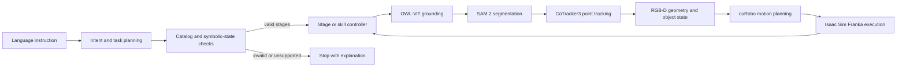

# PseudoVLA - NOT A VLA

**A language-conditioned manipulation research prototype for a simulated Franka arm**

## Abstract

Natural-language robot control is often presented as a direct mapping from an instruction to an action. This project explores a more structured alternative: convert an instruction into a constrained task or skill plan, check that plan against a scene-specific symbolic model, and execute validated stages using visual perception and collision-aware motion planning. Its long-term goal is zero-shot task execution across different robot embodiments: understand new instructions and compose reusable capabilities without training a separate policy for every task or robot. The current prototype is a research testbed in NVIDIA Isaac Sim with a Franka arm and a parallel gripper, not evidence that embodiment-independent zero-shot transfer has already been achieved. It combines local language-model decisions with OWL-ViT object grounding, Segment Anything 2 (SAM 2) masks, OOAL affordance heatmaps for grasp-region selection, online CoTracker3 point tracks, RGB-D geometry, and cuRobo motion planning.

The motivation is to combine the flexibility of zero-shot language understanding with the reliability and inspectability of classical robotics methods. Rather than asking one learned model to infer and directly execute every action, the system uses the model to interpret intent and select among application-provided choices, then relies on explicit symbolic state, precondition checks, geometric perception, motion planning, and conventional low-level control to ground and carry out the task. This separation is intended to make decisions easier to validate, failures easier to localize, and components easier to adapt to another embodiment. These classical components provide structure and constraints, not a proof of safety or reliability; the complete system remains a prototype and is not safety-certified.

## Research motivation

People naturally describe manipulation by goals and relations: *put the mug on the plate*, *stack the blue block on the red block*, or *move the green block to the left*. A robot must resolve these instructions into object references, feasible actions, and physical motions while coping with imperfect visual observations.

The broader research question is whether zero-shot task composition can generalize across embodiments while retaining the predictable interfaces of classical robotics. Reaching that goal requires separating embodiment-independent intent and skill composition from embodiment-specific perception, kinematics, constraints, and control. This repository investigates three practical questions in an initial Franka simulation:

1. **Can language choices be constrained?** The model selects among explicit candidates constructed by the software rather than generating executable code or joint commands.
2. **Can planning and execution share an explicit state?** A symbolic world and stage-level controller track facts such as which object is held and which object supports another, and enforce prerequisites before motion.
3. **Can perception and motion be composed into a small closed-loop system?** Grounding, segmentation, point tracking, RGB-D pose estimates, robot geometry, and collision-aware trajectories feed into staged manipulation.

## System overview

The system has two related task paths: a legacy intent-and-stage controller for direct instructions and an extensible skill-sequence planner. Both use a scene catalog to validate object and location names before physical actions are attempted.



### Planning and state

- **Intent routing and task planning:** Tev1, served locally through Ollama, chooses among explicit options for supported intents, objects, destinations, and skill slots. Python validates the response against the scene and registered skills.
- **Skill registry:** Primitive skills declare their required state, phases, and symbolic effects. A symbolic world represents facts including the held object, support relations, containment, and whether a container is open.
- **Prerequisite handling:** Plans that cannot run immediately may be rejected or repaired through a bounded set of supported prerequisites. Phase authorization and recovery choices are also constrained by code.
- **Staged interaction:** Commands such as approach, grasp, lift, place, release, and retreat can be issued over multiple instructions. Controller context carries grasp and motion information across stages; a bounded transition history records stage outcomes. This allows a later place instruction to use the previously established grasp context instead of assuming every object will be freshly detected.

The language model does not name Python functions, produce robot trajectories, or send joint targets. It is a choice-making component inside a conventional software-controlled execution pipeline.

### Perception

- **OWL-ViT** grounds object phrases in the environment-camera image.
- **SAM 2** segments a grounded object to initialize image-space query points.
- **OOAL affordance prediction** provides heatmaps for supported seen affordances. Tev1 selects a compatible affordance from the supported labels; the controller uses the heatmap within the SAM mask to seed or refine CoTracker points toward a grasp-relevant region.
- **CoTracker3** tracks those points online through subsequent frames. Named groups can track a moving object and, when available, a destination support.
- **RGB-D geometry** unprojects visible points to world coordinates and estimates object centers, dimensions, and surface heights.
- **Wrist and environment cameras** provide complementary views for approach refinement and scene-level tracking.

SAM 2 is released after seeding the tracker to reduce GPU memory use. OOAL is an optional grasp-affordance cue, not a general object or action detector; if its checkout, checkpoint, or a suitable affordance map is unavailable, the controller can fall back to tracking the full segmented object mask. If a target is occluded during a later stage, the controller can use a remembered observation where available; this is a fallback, not a guarantee of current object pose.

### Motion and manipulation

cuRobo generates collision-aware motion for the Franka arm. The controller handles gripper operation, incremental servo motion, approach and lift goals, placement geometry, and release behavior. A lightweight gripper-relative CoTracker check compares tracked object points with their grasp-time position relative to the hand, helping detect apparent slip during motion.

The current workflows include block pick-and-place and stacking, relation-based placement, staged manipulation, and a kitchen scene with a mug and plate. Side grasps use an object-specific orientation and release geometry. These are engineering-specific behaviors for the included scenes, rather than a learned general manipulation policy.

## Current progress

The repository currently contains:

- A runnable Isaac Sim scene/controller path for a Franka arm, with `blocks` and `kitchen` configurations.
- A constrained language interface with catalog-checked objects and destinations.
- A typed task plan and a symbolic skill registry, with prerequisite checking and phase-level execution.
- Visual grounding, segmentation, online point tracking, depth-based geometry utilities, and optional OOAL grasp-affordance guidance.
- Collision-aware arm motion and support-aware placement/release workflows.
- Interactive staged commands whose state persists between user instructions, plus a bounded history of stage transitions.
- A gripper-relative object tracker intended to detect loss of a grasp during lift, transfer, and placement.
- Unit tests for parsing, planning, stage state, tracking, geometry, and workflow behavior.
- A prompt-planning evaluation harness and a recorded baseline. The checked-in decision notes report 50/50 exact step matches and 248 model calls (4.96 calls per plan) for that baseline; this measures the prompt suite, not end-to-end physical task success.

The project is active. The available tests cover many isolated components, but they do not establish robust performance across arbitrary objects, scenes, camera conditions, or instructions. In the current development state, the full unit suite has known failures in five stacking/placement geometry assertions; these should be resolved before treating the test suite as fully passing.

## Repository structure

| Path | Responsibility |
| --- | --- |
| [`scripts/track_and_servo.py`](./scripts/track_and_servo.py) | Executable entry point |
| [`pseudo_vla/cli.py`](./pseudo_vla/cli.py) | Command-line options and Isaac Sim lifecycle |
| [`pseudo_vla/controller.py`](./pseudo_vla/controller.py) | Interactive loop, stage dispatch, and manipulation execution |
| [`pseudo_vla/stage_control.py`](./pseudo_vla/stage_control.py) | Stage instruction parsing, persistent stage state, and prerequisites |
| [`pseudo_vla/task_plan.py`](./pseudo_vla/task_plan.py) | Typed plans, destinations, and scene-catalog validation |
| [`pseudo_vla/task_llm.py`](./pseudo_vla/task_llm.py) | Intent and task-event choices |
| [`pseudo_vla/planner.py`](./pseudo_vla/planner.py) | Skill-sequence planning and prerequisite repair |
| [`pseudo_vla/skills.py`](./pseudo_vla/skills.py) | Skill registry and symbolic world model |
| [`pseudo_vla/phases.py`](./pseudo_vla/phases.py) / [`pseudo_vla/phase_handlers.py`](./pseudo_vla/phase_handlers.py) | Phase authorization, recovery policy, and execution adapters |
| [`pseudo_vla/task_workflow.py`](./pseudo_vla/task_workflow.py) | Task-plan orchestration |
| [`pseudo_vla/stacking_workflow.py`](./pseudo_vla/stacking_workflow.py) | Stacking workflow orchestration |
| [`pseudo_vla/affordance.py`](./pseudo_vla/affordance.py) | Tev1 affordance selection and OOAL heatmap/grasp-region utilities |
| [`pseudo_vla/perception.py`](./pseudo_vla/perception.py) | SAM 2 masks, CoTracker3 query groups, and tracked geometry |
| [`pseudo_vla/grounding.py`](./pseudo_vla/grounding.py) | OWL-ViT object grounding |
| [`pseudo_vla/geometry.py`](./pseudo_vla/geometry.py) | Camera projection, depth, frames, and grasp/placement geometry |
| [`pseudo_vla/motion.py`](./pseudo_vla/motion.py) | Pose execution, gripper control, and camera/tracker updates |
| [`pseudo_vla/servo.py`](./pseudo_vla/servo.py) | cuRobo planning, joint playback, and gripper-relative tracking |
| [`pseudo_vla/scene.py`](./pseudo_vla/scene.py) | Isaac Sim scene setup, cameras, objects, and collision geometry |
| [`pseudo_vla/blocks.py`](./pseudo_vla/blocks.py) / [`pseudo_vla/kitchen.py`](./pseudo_vla/kitchen.py) | Scene object catalogs |
| [`pseudo_vla/tev1_client.py`](./pseudo_vla/tev1_client.py) | Local Tev1/Ollama client |
| [`config/tev1_questions.json`](./config/tev1_questions.json) | Model question definitions |
| [`pseudo_vla/eval_plans.py`](./pseudo_vla/eval_plans.py) | Prompt-suite evaluation |
| [`tests/`](./tests/) | Unit and workflow tests |
| [`DECISIONS.md`](./DECISIONS.md) | Recorded choices for the skill-planning interface |

## Scenes and supported examples

| Scene | Surface | Catalog objects | Example |
| --- | --- | --- | --- |
| `blocks` (default) | `table` | `red`, `green`, `blue` | `stack blue on red` |
| `kitchen` | `counter` | `plate`, `mug` | `hold mug and place it on the plate` |

Destination relations currently include `at`, `on`, `left_of`, `right_of`, and `inside` where supported by the selected workflow and scene catalog. Unsupported names or choices should be rejected rather than sent as arbitrary robot actions.

## Setup

The system depends on NVIDIA Isaac Sim, CUDA-enabled PyTorch, and GPU-based perception/motion packages. Installation and checkpoint setup can be hardware- and driver-sensitive. The tested project setup pins PyTorch to `2.6.0+cu124` because changing it may conflict with the Isaac Sim environment.

### Environment and dependencies

```bash
conda env create -f environment.yml
conda activate ps_vla

pip install torch==2.6.0+cu124 torchvision torchaudio \
  --index-url https://download.pytorch.org/whl/cu124
pip install -r requirements.txt
pip install 'nvidia-curobo==0.8.0.post1.dev43' \
  --extra-index-url https://pypi.nvidia.com
```

Install SAM 2 and its checkpoint, and download the online CoTracker checkpoint to the path expected by `pseudo_vla/perception.py`:

```bash
git clone https://github.com/facebookresearch/sam2.git segment-anything-2
SAM2_BUILD_CUDA=1 pip install -e segment-anything-2

mkdir -p checkpoints
wget -O checkpoints/sam2_hiera_base_plus.pt \
  https://dl.fbaipublicfiles.com/segment_anything_2/072824/sam2_hiera_base_plus.pt
mkdir -p ~/.cache/torch/hub/checkpoints
wget -O ~/.cache/torch/hub/checkpoints/scaled_online.pth \
  https://huggingface.co/facebook/cotracker3/resolve/main/scaled_online.pth
```

The first run may also download OWL-ViT weights and Isaac Sim assets. Tev1 is expected to be available through a local Ollama server; the project instructions use:

```bash
ollama pull tev1:4b
```

OOAL affordance-guided grasping additionally requires a local OOAL checkout at `OOAL/` and a compatible seen-class checkpoint at `checkpoints/ooal-models/seen_best` or `OOAL/models/checkpoints/seen_best`. The controller uses OOAL heatmaps to localize an instructed/selected affordance within the object mask and prioritize CoTracker points for grasping. OOAL is optional: if its checkout or checkpoint is missing, or no suitable heatmap/region is available, the controller reports the condition and can fall back to tracking the full segmented object mask. This fallback does not provide equivalent affordance-level grasp localization.

### Run

```bash
export OMNI_KIT_ACCEPT_EULA=YES
python scripts/track_and_servo.py
```

Useful invocations:

```bash
python scripts/track_and_servo.py --instruction "stack blue on red"
python scripts/track_and_servo.py --scene kitchen \
  --instruction "hold mug and place it on the plate"
python scripts/track_and_servo.py --stack-prompt "stack green, then red, then blue"
python scripts/track_and_servo.py --headless
python scripts/track_and_servo.py --max-steps 600
```

In interactive mode, enter natural-language commands at `Instruction>`. `home` returns the arm to its startup pose and `quit` exits. Run `python scripts/track_and_servo.py --help` for the current CLI options.

### Tests and evaluation

Run the unit suite with:

```bash
python -m unittest discover -s tests -v
```

The prompt evaluation harness and its recorded baseline are under `pseudo_vla/eval_plans.py` and `tests/prompts/`. Prompt selection scores should not be interpreted as physical task success: they do not evaluate perception accuracy, grasp stability, collision avoidance in all conditions, or completion across varied simulator states.

## Limitations and open problems

1. **Narrow task and scene coverage.** The object catalogs, geometry assumptions, and tested workflows are built around a small set of blocks and kitchen props. New objects and tasks require catalog, perception, geometry, and controller integration.
2. **Simulation-specific validation.** The current target is Isaac Sim. The code is not a hardware driver and has not been validated as a safe real-robot controller.
3. **Visual detection and occlusion.** OWL-ViT may fail to identify an object in a particular view. Remembered observations and support geometry can help when a plate is temporarily occluded, but stale context can be wrong if the scene changes.
4. **Tracking and grasp verification.** The gripper-relative tracker is a lightweight heuristic based on sparse tracked points and depth. It can miss loss events when points are invisible or depth is poor, and it is not force-, tactile-, or contact-based verification.
5. **Affordance coverage and dependencies.** OOAL supports a finite set of seen affordance classes and requires separate code, model weights, and checkpoints. Heatmaps can be unavailable or fail to identify a useful grasp region; full-mask tracking is a fallback, not an equivalent substitute. Generalization to unseen affordances and objects is unestablished.
6. **Geometric approximations.** Placement uses estimated dimensions, tracked surface points, or remembered support bounds. These approximations can be inaccurate for irregular, transparent, reflective, or deformable objects and can produce unsafe goals if perception is wrong.
7. **Language-model reliability and latency.** Constrained choices reduce the model's authority but do not guarantee correct intent resolution. Local model responses can still be malformed, ambiguous, or slow; failures should stop planning rather than be treated as successful execution.
8. **Hardware and memory requirements.** Isaac Sim, perception models, and cuRobo share a GPU. Installation, CUDA compatibility, checkpoint availability, and VRAM can limit reproducibility; a GPU with substantial memory is recommended.
9. **Evaluation maturity.** The checked-in prompt baseline evaluates planning choices, not end-to-end manipulation success. The full unit suite currently has five known placement/stacking geometry failures, and broader simulation trials and quantitative robustness measures remain future work.


## Related work and components

The implementation builds on public tools and models including [NVIDIA Isaac Sim](https://developer.nvidia.com/isaac/sim), [cuRobo](https://github.com/NVlabs/curobo), [OWL-ViT](https://github.com/google-research/scenic/tree/main/scenic/projects/owl_vit), [Segment Anything 2](https://github.com/facebookresearch/sam2), and [CoTracker](https://github.com/facebookresearch/co-tracker). These systems provide simulation, motion planning, open-vocabulary grounding, segmentation, and point tracking; this repository integrates them into a constrained language-to-manipulation pipeline.
